# visionmaster

> 面向工业检测、识别、测量与机器人引导的可视化机器视觉平台。
>
> C++ / Qt 6 / OpenCV / OpenVINO / ONNX

本平台对标海康visionmaster开发，在其基础上进行了更强的优化升级，将图像采集、定位、测量、字符识别、缺陷检测与设备通信整合到统一的工作环境中。工程人员通过拖拽模块、配置参数和关联数据，搭建从采图到结果输出的完整检测流程，并在图像上直接查看定位轮廓、测量标注、识别内容与缺陷位置。

平台结合传统视觉算法、少样本学习与深度学习推理，可根据任务选择规则检测、样本学习或模型推理，也可在同一流程中组合使用。适用于外观与字符检查、部件有无与计数、尺寸测量、工装对位、机器人上下料引导等任务，支持从样本验证、参数调试到设备联调和现场运行的工程实施过程。

此外，海康visionmaster不具备跨平台能力，但本平台可以在多系统（windows、ubuntu、国产麒麟）部署。

## 核心能力

- **可视化流程编排**：拖拽搭建流程，支持数据订阅、条件与字符分支、组合模块、子流程及变量运算；可逐模块调试，也可由外部设备触发整套检测。
- **定位与匹配**：提供轮廓匹配、Blob 分析、直线、圆、椭圆、多圆及四边形查找等工具。配合位置修正，让下游检测区域和卡尺跟随目标的位置与角度变化。
- **2.5D 定位引导**：结合相机标定、手眼标定与视觉标记识别，完成工位重定位和已示教目标的位姿更新，输出机器人坐标系下的位置与姿态，适用于工装对位、上下料及移动作业设备到站后的定位补偿。
- **字符与标识识别**：支持文本定位、OCR、条码与二维码识别，输出内容、位置及相应置信度，便于进行标签核验、信息提取和后续条件判断。
- **深度学习视觉**：支持目标检测、旋转目标检测、实例分割、语义分割与图像分类，可将适配模型的推理结果接入计数、定位、判定与通信流程。
- **边缘学习与缺陷检测**：提供学习计数、有无检测、多类别分类、异常分类、字符缺陷检测和良品学习缺陷检测。通过注册样本、设定检测区域和阈值，完成面向具体任务的检测配置。
- **标定与测量**：支持尺寸标定、坐标转换与点线圆几何测量，通过 ROI 和交互式卡尺提取实际边缘，完成距离、角度、直径及间隙等几何检查，并在图像上显示测量标注。
- **图像与颜色处理**：提供光照校正、二值化、形态学、图像增强、颜色转换与分割等工具，配合圆环展开、图像融合和清晰度评估，为后续识别、测量与缺陷检查准备图像。
- **工业集成**：支持相机采集、TCP、UDP、串口及 Modbus TCP 主站通信，可与 PLC、机器人和上位系统交换触发指令、检测结果、测量值及坐标；支持脚本扩展与项目接口适配。
- **运行查看与异常复核**：通过检测图层、运行日志和生产运行视图查看结果；按需开启检测追溯，回看已保存的当次图像与图层，辅助定位异常。
- **离线帮助中心**：内置模块用途、输入输出、参数说明、推荐流程和操作提示，可按模块或关键词查询，便于现场调试与人员交接。
- **在线更新与版本维护**：接入更新服务后，可在软件内检查新版本、下载并校验更新包、查看更新说明，由用户选择立即安装或稍后处理，便于现场获取功能改进与问题修复，安排设备维护时间。
- **跨平台架构**：基于 C++、Qt 6 与 CMake，支持 Windows、Linux 部署，并面向麒麟等国产操作系统进行适配。相机驱动、推理后端及外设支持按实际环境确认；智能相机嵌入式部署为后续拓展方向。

## 功能展示

以下以实际软件截图展示功能配置、检测图层与模块库。点击图片可查看原图；模块面板按软件功能栏命名，较长分类完整展开，便于查阅全部工具。

### 2.5D 定位引导

面向工装对位、上下料和工位重定位，结合相机标定、手眼标定与视觉标记识别，计算目标相对于机器人或工位的位姿。当工装位置发生变化时，可更新已示教目标的位置，为后续取放提供视觉依据。

典型配置过程：**标定 → 示教基准与目标 → 识别工位标记 → 解算并检查位姿 → 向控制系统输出结果**。机器人运动路径与执行由控制系统完成。

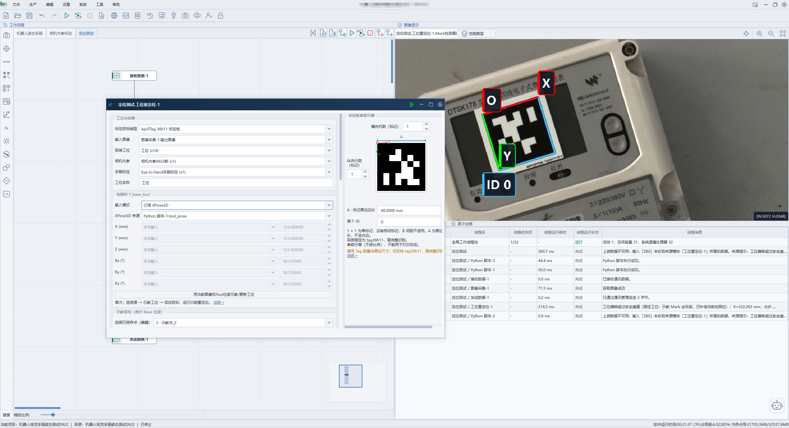

图中展示工位重定位的配置入口与标记坐标图层。完成标定、示教和位姿有效性检查后，再将结果接入机器人控制流程。

### 字符缺陷检测

用于固定字符画面、LCD 全段显示、刻字和印刷内容的缺段、漏字、异常笔画及脏污检查。支持定位基准、字符区域与屏蔽区配置、逐字符检查及合格样本统计训练，并在图像上标出异常字符和缺陷区域。

**字符缺陷检测关注字符是否完整，OCR 关注字符写了什么。** 对于内容会变化的读数或编号，可先用 OCR 读取，再结合任务期望值核验；固定字符缺陷模型需与对应的显示状态或印刷内容匹配。

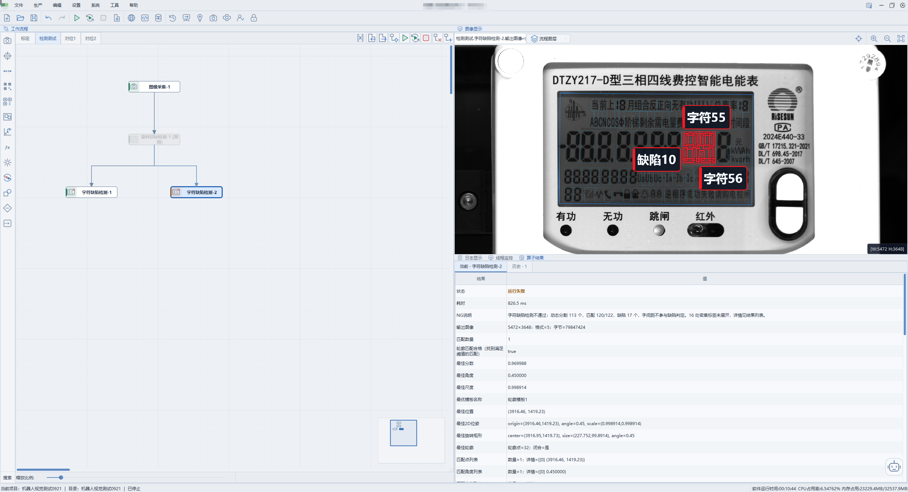

图中将异常字符与缺陷位置直接标注在原图上，操作人员可结合下方结果列表查看未通过原因，定位需要复核的显示区域。

### 轮廓匹配与位置修正

通过目标轮廓建立模板，在设定范围内搜索位置、角度和尺度，输出匹配分数及位姿。位置修正将定位结果传递给后续检测，使 ROI、卡尺和识别区域跟随目标移动，适合存在来料偏移、摆放旋转或工装重复定位误差的场景。

典型流程：**图像采集 → 轮廓匹配 → 位置修正 → 字符识别、尺寸测量或缺陷检测**。定位与精检测分开配置，便于分别调整搜索范围和检测参数。

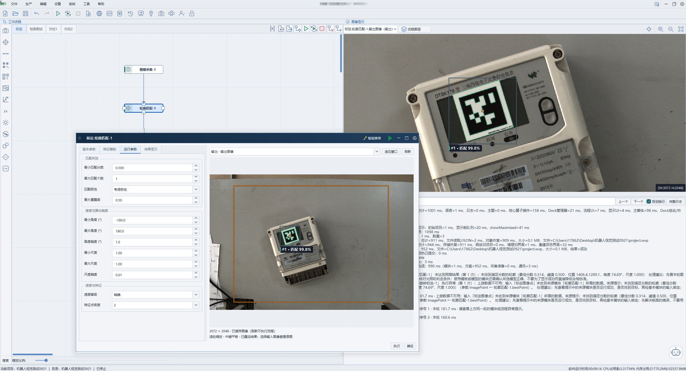

### 字符定位与 OCR 识别

从图像中定位文字并识别内容，输出文本、区域及识别分数，可用于铭牌、标签、包装文字和设备编号读取。识别结果可继续参与字符串处理、内容比对、条件分支和通信输出。

对于背景复杂或目标位置变化的任务，可先用定位模块确定目标，再限定文字区域；需要判断内容是否正确时，应结合期望值和业务规则，不能仅以“识别成功”作为合格依据。

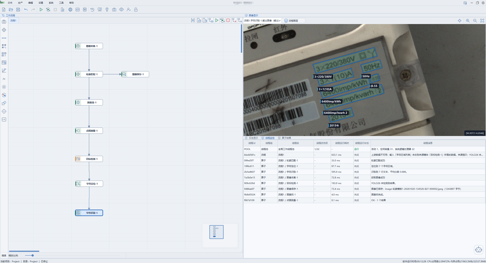

### 深度学习目标检测

加载适配的目标检测模型，输出目标类别、位置、数量与置信度，并将检测框和标签叠加到图像上。适合部件定位、目标计数、指定对象有无检查，也可作为后续 OCR 或精细检测的区域来源。

通过置信度、重叠过滤和检测区域等参数筛选结果。检测效果与模型训练范围、样本覆盖和现场成像条件相关，部署前可使用实际样本验证。

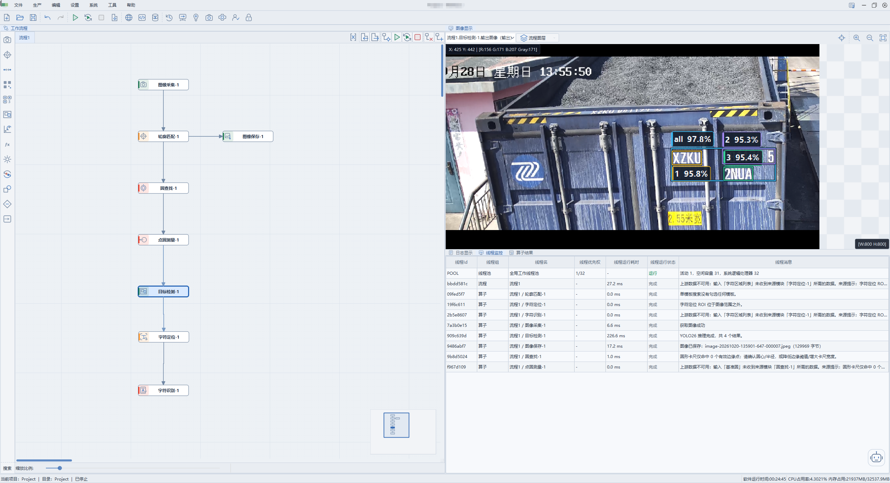

### 采集功能模块

连接相机或读取本地图像，配合光源控制与图像保存，建立从成像到样本留存的入口。调试阶段可使用本地样本验证参数，设备联调时再接入实际相机和触发方式。

典型流程：**图像采集 → 定位或检测 → 结果判定 → 按需保存图像**。

<a href="doc/readme/modules/采集.png">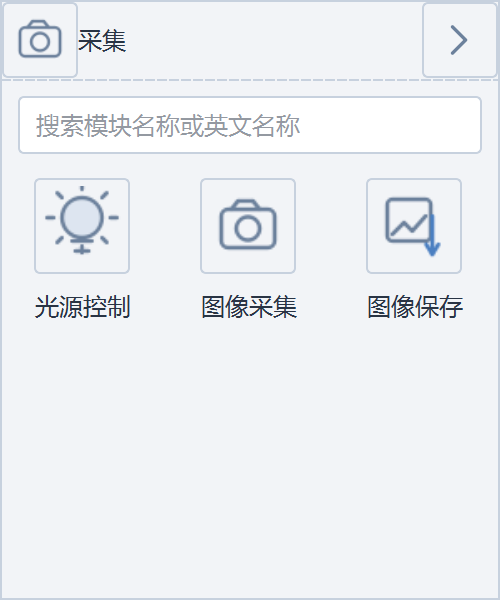</a>

### 定位功能模块

覆盖轮廓、直线、圆、椭圆、平行线、多圆及四边形等常用几何特征。通过交互式 ROI 和卡尺设定搜索范围、边缘方向与检测参数，查看命中点和拟合结果，再将几何结果交给下游测量模块。

点圆、线圆、圆圆等测量既可订阅上游几何结果，也可使用模块内的检测卡尺提取实际边缘。目标存在位移时，可接入位置修正，减少逐个调整检测区域的工作。

除定位工具外，该分类还包含轮廓比对、亚像素卡尺及直线、圆弧、边缘对和边缘模型缺陷工具，可围绕边缘完整性与宽度变化配置检查。

<a href="doc/readme/modules/定位.png">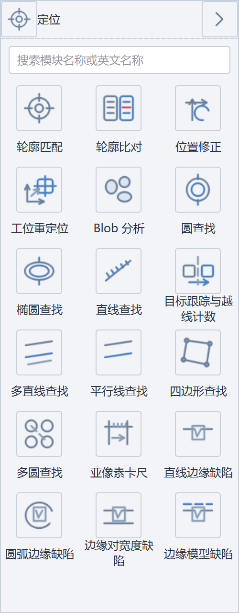</a>

### 测量功能模块

围绕点、直线与圆建立几何关系，提供点点、点线、线线、点圆、线圆和圆圆测量，以及几何拟合与边缘位置趋势分析。适用于孔距、边距、夹角、装配间隙及边缘偏移检查。

典型流程：**定位目标 → 提取边缘或订阅几何结果 → 测量 → 与允许范围比较 → 输出判定**。测量值应与单位、标定关系及公差一起配置，得到数值不等于完成合格判定。

<a href="doc/readme/modules/测量.png">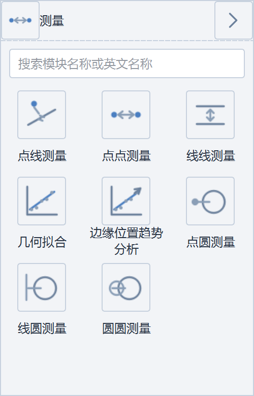</a>

### 识别功能模块

提供条码、二维码、字符定位和字符识别，支持将产品标识转为可供后续流程使用的文本。可用于编号采集、标签内容核验和读码结果分流。

典型流程：**采集图像 → 限定识别区域 → 读取内容 → 比对期望值或规则 → 输出文本与判定**。

<a href="doc/readme/modules/识别.png">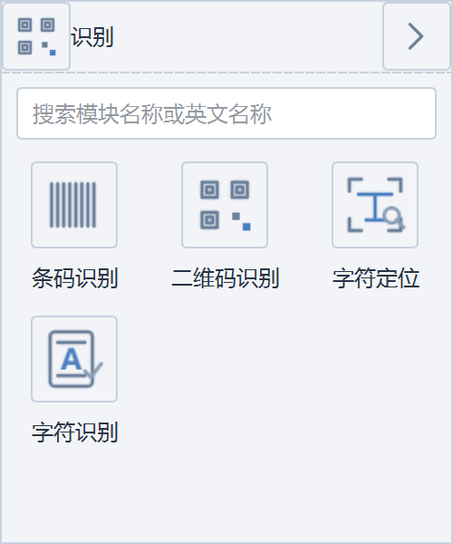</a>

### 边缘学习功能模块

通过注册代表性样本建立检测依据，适合任务边界明确、需要快速验证的现场应用。不同模块对应不同问题，可根据是否需要类别、数量或缺陷位置选择：

- **学习计数**：定位同类目标并统计数量，输出目标框、中心点和置信度。
- **有无检测**：注册目标与背景样本，判断指定部件是否存在，适合装配缺件或附件检查。
- **多类别分类**：登记不同类别样本，用于型号、正反面、状态等外观分类。
- **异常分类**：注册 OK 与 NG 样本，判断当前区域更接近哪类外观。
- **良品学习缺陷检测**：以合格样本建立正常外观参考，检测偏离正常外观的区域，适合缺陷样本难以完整收集的任务。
- **字符缺陷检测**：对固定字符内容进行逐字符检查，定位缺段、漏字与局部差异。
- **样本图像检索**：在已登记样本中查找相似图像，为样本比对和人工复核提供参考。

典型配置过程：**确定检测区域 → 注册代表性样本 → 学习或建立样本库 → 使用独立样本验证 → 调整判定阈值**。

<a href="doc/readme/modules/边缘学习.png">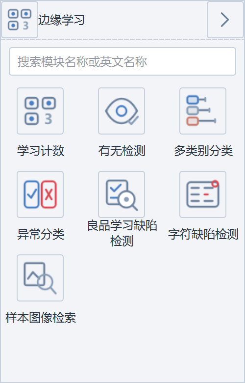</a>

### 深度学习功能模块

提供不同任务类型的模型推理入口，沿用一致的图像输入、参数配置、结果显示与数据订阅方式，便于与传统视觉模块组合。

- **目标检测**：用矩形框给出目标位置、类别和置信度。
- **旋转目标检测**：给出带方向的目标框，适合倾斜或旋转目标的定位。
- **实例分割**：区分单个目标并输出各自区域，便于统计和后续几何分析。
- **语义分割**：按类别标记图像区域，用于区域提取及覆盖范围分析。
- **图像分类**：判断图像或指定区域所属类别，用于状态识别和结果分流。

模型需符合对应模块支持的输入输出格式；检测类别与适用范围由具体模型决定。

<a href="doc/readme/modules/深度学习.png">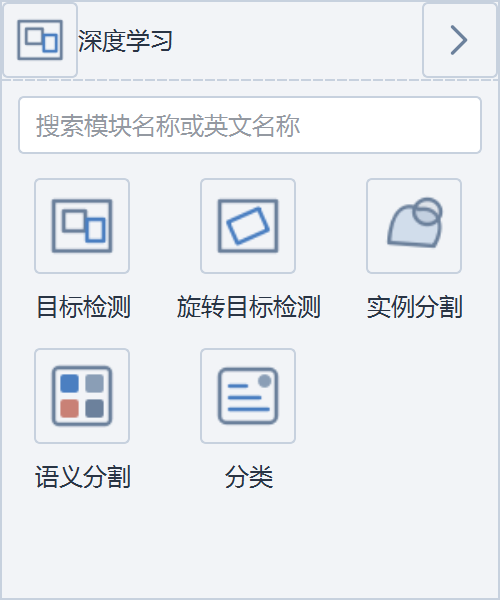</a>

### 标定功能模块

提供平移旋转标定、相机内参标定、Eye-in-Hand 手眼标定及标定转换，将图像中的定位结果与实际工位或机器人坐标联系起来。适用于平面对位、机器人引导与工位重定位前的基础配置。

按实际安装方式选择标定流程，采集足够的标定点或姿态，检查标定误差，再用独立位置验证转换结果。2.5D 引导还需结合工位基准、已示教目标及拍照时的机器人位姿。

<a href="doc/readme/modules/标定.png">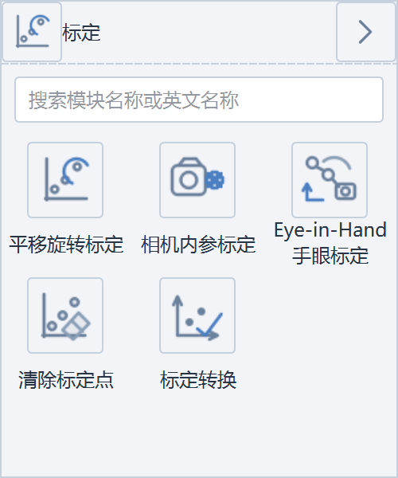</a>

### 图像处理功能模块

通过二值化、形态学、图像增强和光照校正突出有效特征；通过仿射变换、图像运算、平移拼接、加权融合和帧平均整理输入图像。圆环展开便于查看环形区域，清晰度评估可辅助检查成像质量。

典型流程：**采集图像 → 按问题选择预处理 → 定位、识别或缺陷检测**。例如先校正不均匀光照再分割区域，或展开圆环后检查连续边缘。

<a href="doc/readme/modules/图像处理.png">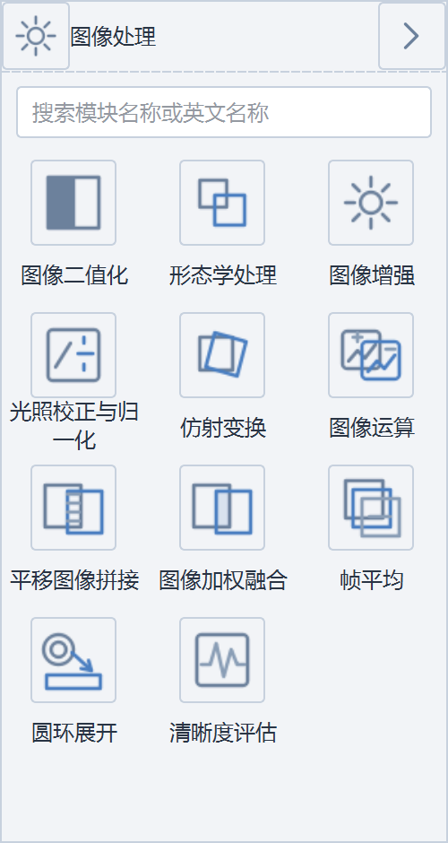</a>

### 颜色处理功能模块

提供颜色转换、颜色抽取、颜色测量、颜色分割与颜色识别，可用于指定颜色区域提取、颜色状态检查和不同外观的区分。颜色处理结果可继续接入 Blob 分析、区域测量或条件判断。

典型流程：**固定曝光与白平衡 → 选择颜色区域 → 测量或分割 → 设置范围与判定规则**。使用实际光源和物料样本验证阈值，可减少成像变化对颜色判断的影响。

<a href="doc/readme/modules/颜色处理.png">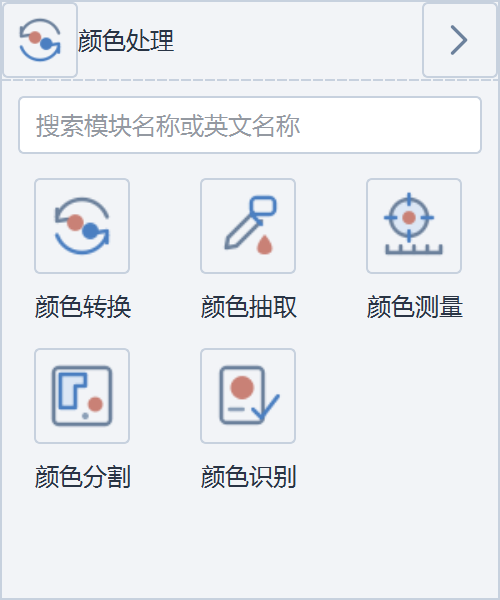</a>

### 运算功能模块

提供对位计算、建立定位基准、变量计算和变量赋值，将上游检测结果组织成后续流程需要的数据。适用于基准与当前位置比较、检测数值计算、参数传递和结果汇总。

可将定位、测量或识别输出作为输入，再把计算结果订阅到条件分支、下游检测参数或通信输出。

<a href="doc/readme/modules/运算.png">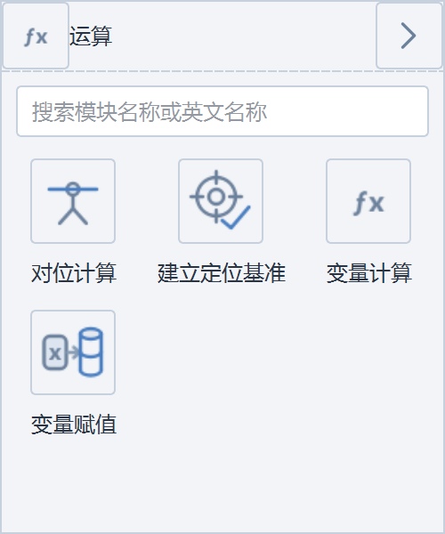</a>

### 图形生成功能模块

通过几何创建生成所需的几何对象，为测量、区域配置或数据订阅提供参考。适用于有明确设计坐标、需要构造参考几何的任务；需要提取实物边缘时，应使用定位类的查找或卡尺工具。

<a href="doc/readme/modules/图形生成.png">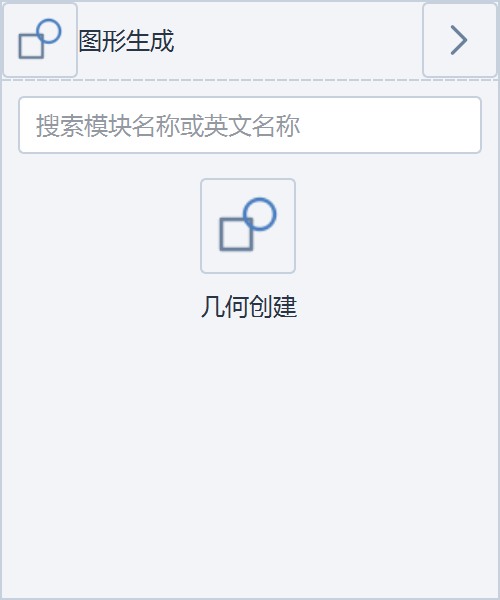</a>

### 逻辑工具功能模块

利用条件分支、字符分支、延时、Python 脚本与 Group 组织执行过程。可按检测结果进入不同后续步骤，按接收指令选择检测任务，或将重复功能封装为组合模块。

典型流程：**接收任务指令 → 字符分支 → 执行对应检测 → 条件判断 → 汇总并回复结果**。脚本用于扩展计算与接口适配，基础任务也可直接用可视化模块搭建。

<a href="doc/readme/modules/逻辑工具.png">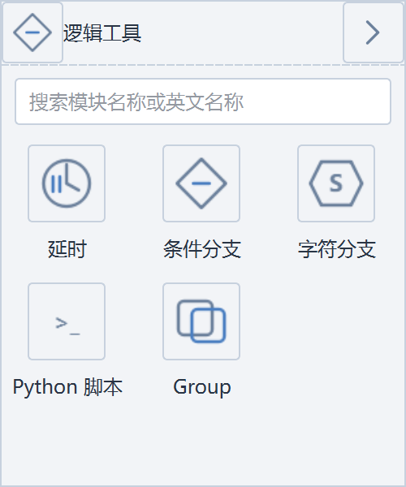</a>

### 通信功能模块

通过接收数据与发送数据模块选择工程内已配置的通信设备，与 PLC、机器人或上位系统交换任务指令、检测结果、测量值与坐标。通信设备及连接参数在设备管理中统一配置。

典型对接过程：**配置设备与报文格式 → 验证收发 → 设置流程触发 → 解析任务指令 → 检测并回复**。接收历史可辅助核对原始报文，必要时切换十六进制查看。

<a href="doc/readme/modules/通信.png">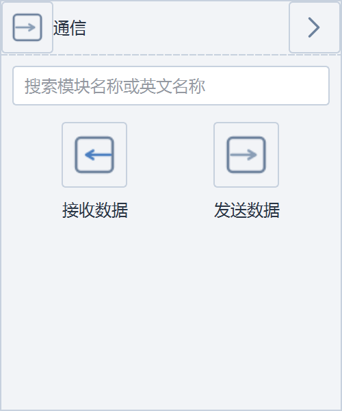</a>

### 内置离线帮助中心

将模块用途、输入输出、参数说明、推荐流程与常见问题集中在软件内，支持按分类浏览和关键词检索，无网络环境也可查阅。调试时可对照模块说明确认数据来源、参数含义和结果用法，降低工程交接与后续维护的门槛。

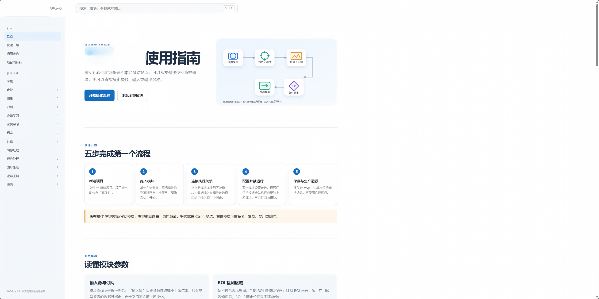

## 技术方向：Vision Agent

当前正在探索将多模态大模型与平台的模块、参数及运行结果结合，让用户能够用自然语言描述检测需求，由系统辅助推荐工具、生成流程并解释结果。Vision Agent 是后续研发方向，以下能力不作为当前版本已交付功能。

设想包括：

- **需求到流程**：根据检测对象、检查项目和判定条件，推荐模块组合并生成可检查、可修改的流程草案。
- **图像到配置**：结合图像内容，辅助设计 ROI、创建模板，给出定位策略和参数建议。
- **样本到验证**：结合合格与不合格样本核对结果，辅助发现漏检、误判及参数不适配问题。
- **运行到诊断**：结合运行日志、模块输入输出与检测图层，解释异常原因并给出调试建议。

如需试用、评估检测方案或交流设备集成需求，欢迎联系。

公司官网：https://101.201.121.227:30300/
微信&电话：`17862923747`，请注明来意，谢谢

## 声明

本页用于产品能力与工程实践展示。示例图片中的检测对象、识别结果及耗时不作为项目性能承诺；具体检测效果、节拍和软硬件适配范围以实际样本及部署环境验证为准。第三方框架、模型及依赖遵循各自的许可约定。
